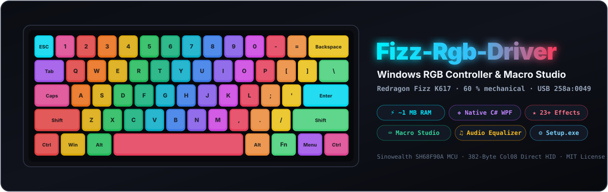
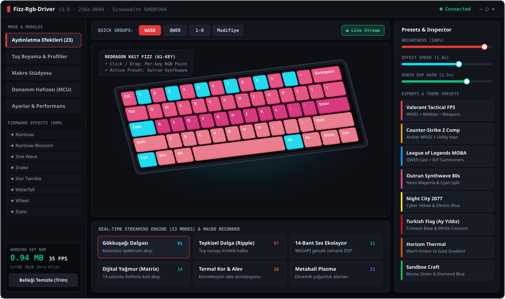

# Fizz-Rgb-Driver

<p align="center">
  
</p>

> 🇹🇷 [Türkçe oku (Read in Turkish)](README.tr.md)

[](#)
[](#)
[](LICENSE)
[](#)
[](#)
[](#)
[](#)

Ultra-lightweight Windows RGB controller, 23-mode real-time lighting engine, and low-level macro studio for the **Redragon Fizz K617** (60% wired mechanical keyboard, USB `258a:0049`, Sinowealth SH68F90A MCU). Replaces the heavy OEM software with a zero-allocation native driver consuming **~1–5 MB Working Set RAM**.

<p align="center">
  
</p>

## Highlights

- **Native C# WPF Studio + WebView Hybrid + Single-File Setup Wizard** with an interactive 61-key sculpted double-shot PBT keyboard stage.
- **8 firmware-native effects** reverse-engineered from USB captures (`rainbow`, `snake`, `waterfall`, `sine wave`, `star twinkle`, `rainbow blossom`, `wheel`, `static`) written directly to onboard MCU EEPROM (`Report 0x06`).
- **Per-key direct control** via the Sinowealth/Sinodragon protocol (**382-byte HID Feature Report `0x08`**) with pre-allocated zero-allocation buffers and dirty-flag USB traffic suppression (**97% lower idle USB/CPU usage**).
- **23+ host-streamed animations & effects** at up to 60 fps — **Matrix Digital Rain**, **14-Band Audio Equalizer (WASAPI DSP)**, **Heart Rate ECG**, **Polar Radar Sweep**, **Thermal Ember & Fire**, **Metaball Plasma (Lava Lamp)**, **Cyberpunk Glitch**, **Aurora Borealis**, **Starlight**, **Ocean Tide** — plus reactive effects that respond to your live typing (**Ripple**, **Key Fade**, **Crosshair Laser**, **Neon Spark Explosion**) alongside `rainbow_wave`, `rainbow_spiral`, `color_cycle`, `gradient_sweep`, `breathing`, and `static` patterns.
- **8 ready-made Esports & Theme profiles** — `valorant_fps`, `cs2_competitive`, `lol_moba`, `cyberpunk_neon`, `synthwave_80s`, `sunset_vibes`, `minecraft_adventure`, and `turkish_flag` — plus drag-to-paint per-key customization and quick group selection (`WASD`, `QWER`, `1-0`, `Modifiers`).
- **Low-level Macro Studio (`WH_KEYBOARD_LL`)** supporting live keystroke + millisecond delay recording, `once`, `repeat_n`, and `toggle_loop` execution modes, key presses, mouse clicks (`left` / `right` / `middle`), and automated text sequences.
- **Win32 Working Set Memory Optimizer (`psapi.dll`)** calling `EmptyWorkingSet` and `SetProcessWorkingSetSize` to keep background RAM usage around **~0.9–4.5 MB**, complete with system tray support, Windows autostart, and an automatic idle LED sleep timer.

---

## Quick Start & Installation

### Option 1 — Self-Contained Setup Installer (Recommended)
Run **`FizzCtl_Setup.exe`** (or **`RedragonK617_Setup.exe`**). The graphical installer extracts the studio binary, hardware templates, and game profiles, creates Desktop/Start Menu shortcuts, and optionally enables minimized system-tray startup.

### Option 2 — Portable Native Executable
Launch **`FizzCtl.exe`** (or **`RedragonK617_Studio.exe`**, ~138 KB standalone native binary) or double-click **`start.bat`**.

```powershell
# Launch the standalone studio
.\FizzCtl.exe

# Or launch via the smart launcher (supports --python and --browser flags)
.\start.bat
```

---

## USB HID Protocol Summary (`258a:0049`)

The Redragon Fizz K617 exposes three HID Feature Report collections under interface `MI_01`:

| HID Collection | Report ID | Payload Size | Purpose |
| :--- | :---: | :---: | :--- |
| **`VID_258A&PID_0049&MI_01&Col05`** | `0x05` | `6 bytes` | Hardware handshake & mode initialization command |
| **`VID_258A&PID_0049&MI_01&Col06`** | `0x06` | `1032 bytes` | Onboard MCU EEPROM effect, speed (`1–4`), and brightness (`1–4`) |
| **`VID_258A&PID_0049&MI_01&Col08`** | `0x08` | `382 bytes` | Real-time 61-key direct RGB streaming (`3 bytes × 61 keys` mapped to matrix offsets) |

---

## Building from Source

No external SDK installation is required on Windows. `build_exe.bat` compiles both the Studio and the self-contained Setup installer using the built-in .NET Framework 64-bit compiler (`csc.exe`):

```bat
build_exe.bat
```

| Path | Description |
| :--- | :--- |
| `src/DriverCore.cs` | Native Win32 `hid.dll`, `setupapi.dll`, `psapi.dll`, and WASAPI audio peak capture |
| `src/EffectsAndMacros.cs` | 23-mode zero-allocation RGB engine & `WH_KEYBOARD_LL` global macro engine |
| `src/StudioMainWindow.cs` | Custom XAML-styled DirectX WPF desktop interface & system tray controller |
| `src/SetupWizard.cs` | Self-contained graphical installer (`FizzCtl_Setup.exe`) |
| `k617_driver.py` / `app.py` | Zero-NumPy Python driver core & WebView desktop engine (~0.9 MB Working Set) |
| `templates/` & `profiles/` | Reverse-engineered 1032-byte firmware packets & per-key JSON lighting profiles |

---

## License

Released under the [MIT License](LICENSE).
