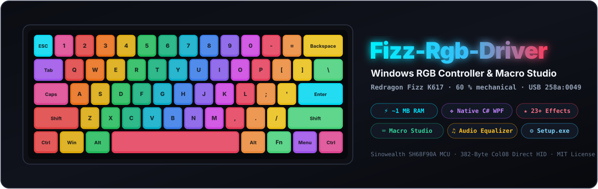
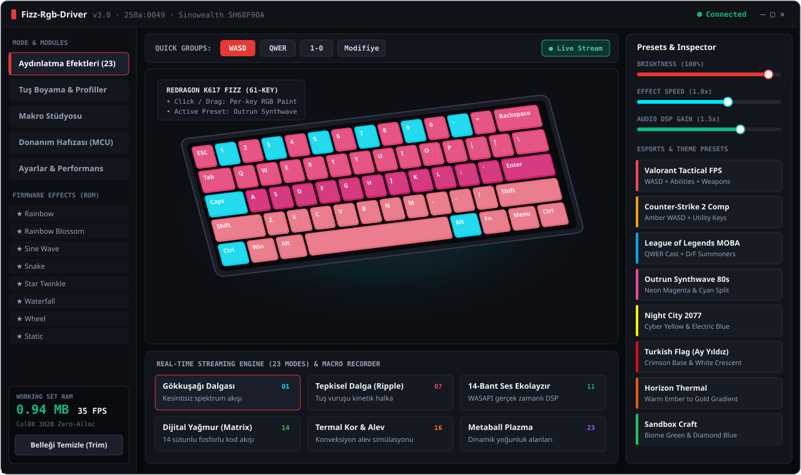

# Fizz-Rgb-Driver (Türkçe Dökümantasyon)

  

> 🇬🇧 [Read in English (README.md)](README.md)

**Redragon Fizz K617** (%60 mekanik klavye, USB `258a:0049`, Sinowealth SH68F90A MCU) için sıfırdan geliştirilmiş; arka planda yalnızca **~0.9 – 5 MB Working Set RAM** tüketen açık kaynaklı Windows RGB sürücüsü, 23 modlu gerçek zamanlı efekt motoru ve makro stüdyosu.

  

## Öne Çıkanlar

- **Native C# WPF Masaüstü Uygulaması + Tek Dosya Kurulum Sihirbazı (`Setup.exe`):** 61 tuşlu çift katmanlı (Double-Shot PBT) interaktif klavye sahnesi.
- **8 Dahili Çip (Onboard MCU) Efekti:** USB paket yakalamalarından tersine mühendislikle çıkarılan `rainbow`, `snake`, `waterfall`, `sine wave`, `star twinkle`, `rainbow blossom`, `wheel`, `static` modları doğrudan klavye hafızasına yazılır (uygulama kapalıyken bile çalışır).
- **382-Bayt `Col08` Doğrudan Tuş-Tuş RGB Akışı:** Önceden ayrılmış (*zero-allocation*) tampon bellek ve *Dirty-Flag* USB trafik koruması ile sabit modlarda %97 daha az arka plan yükü.
- **23+ Canlı Animasyon ve Ses/Tepki Modu:** Matrix Dijital Yağmur, 14-Bant Ses Ekolayzır (WASAPI), EKG Kalp Ritmi, Polar Radar, Termal Kor & Alev, Metaball Plazma (Lav Lambası), Cyberpunk Glitch, Kuzey Işıkları ve yazı hızınıza tepki veren *Ripple*, *Key Fade*, *Crosshair Lazer*, *Kıvılcım Patlaması* modları.
- **8 Hazır Espor & Tema Profili:** `Valorant FPS`, `Counter-Strike 2`, `League of Legends MOBA`, `Türk Bayrağı`, `Night City 2077`, `Outrun Synthwave`, `Horizon Termal`, `Sandbox Craft`.
- **Düşük Seviyeli Makro Stüdyosu (`WH_KEYBOARD_LL`):** Canlı tuş ve gecikme kaydı, *Tek Sefer*, *N Tekrar* ve *Aç/Kapa Döngü* modları.
- **Win32 Working Set RAM Temizleyici (`psapi.dll`):** `EmptyWorkingSet` çağrısıyla ~1 MB seviyesinde bellek kullanımı, Sistem Tepsisi (Tray) desteği ve boşta LED uyku zamanlayıcısı.

## Lisans

[MIT Lisansı](LICENSE) altında yayınlanmıştır.
